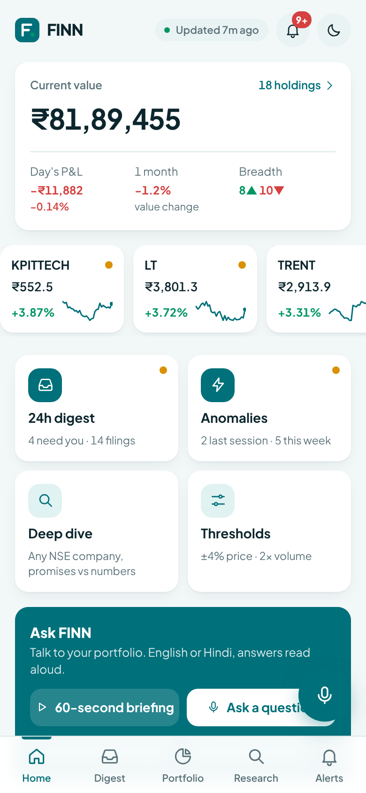
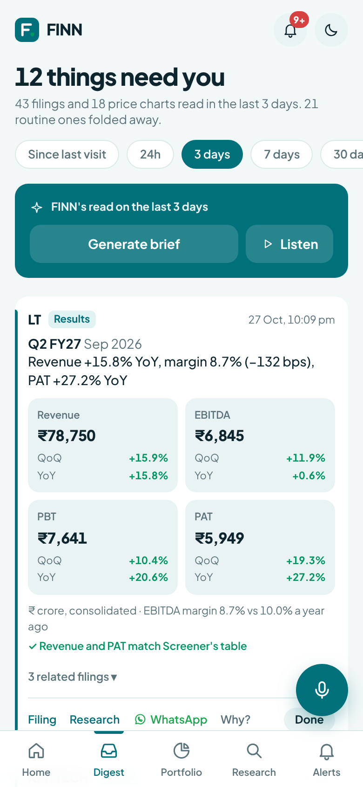
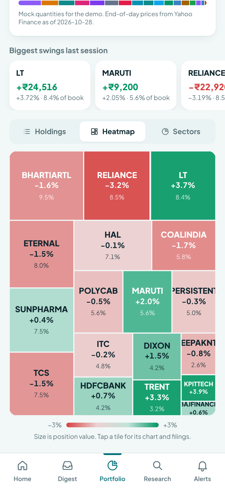
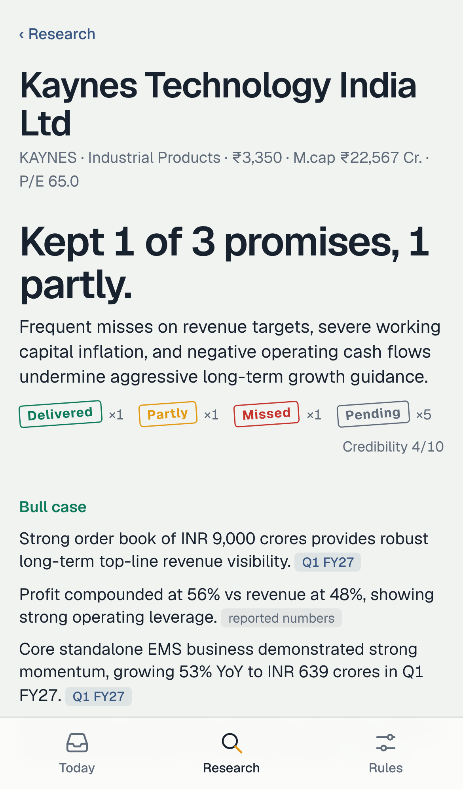
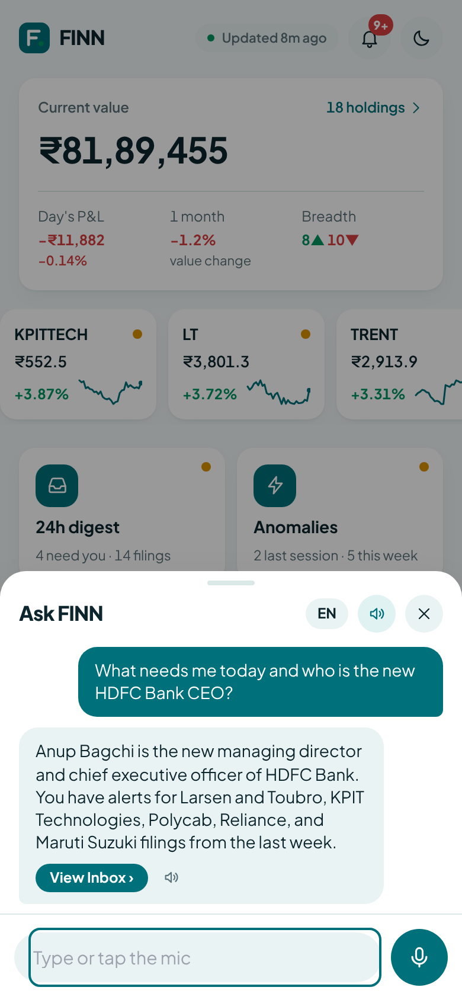

# FINN

A mobile-first investment agent for a portfolio manager who has ninety seconds between meetings.

**Live** https://finn-opal-delta.vercel.app (open it on a phone. "Add to Home Screen" makes it an app and turns on lock-screen alerts on iPhone)
**Telegram** [@FinnEnamBot](https://t.me/FinnEnamBot). Press Start and you get the alerts, or just ask it something.

<p>





</p>

FINN does three things.

**It reaches out (Push).** Every filing your 18 holdings make on BSE, plus their end-of-day price and volume, is read and ranked. You pick the window (since last visit, 24 hours, 3, 7 or 30 days) and get an inbox you can finish. Three to five things need you, the rest is folded away. Results come as Revenue, EBITDA, PBT and PAT against last quarter and last year, read from the actual results PDF. A CEO change tells you who the new person is and where they came from. A stock that moved more than *your* threshold shows up next to them. Whatever crosses your thresholds also reaches you without opening the app, as a phone notification, on Telegram, or as an evening wrap after market close.

**You dig in (Pull).** Type any NSE company. FINN reads its last four earnings calls and its latest annual report, and checks what management promised against what the company later reported. Every claim links to the page it came from, and every management quote is string-matched against the PDF. Companies that don't hold calls (OFSS, for one) are judged on their annual reports. The financial sections (price chart, results, trajectory, balance sheet, cash quality) are computed in code, with no model in the loop.

**You can just ask.** Tap Ask at the top of any screen and speak. "What needs me today?", "Who is HDFC Bank's new CEO?", "Did Titan deliver on its guidance?". FINN answers aloud from its own data and opens the screen that shows the detail. The same copilot answers typed questions and voice notes on Telegram.

## Why it looks like this

An investor doesn't lack information. They lack a way to stop reading. So the home screen is not a feed, it's a list with an end. The headline is a count ("3 things need you"), because the first question every morning is "how much do I have to deal with?".

The investor decides what "unusual" means. The thresholds screen shows how many alerts your settings would have produced over the last 30 days, so you see how noisy a choice is before you make it. The in-app Inbox, phone notifications and Telegram all use the same rules, so nothing reaches one channel that the others wouldn't show.

On the research side, summarising management is cheap and everyone does it. The useful question is whether management can be believed. So the first thing you see is "Kept 4 of 7 promises", and every row of the promise ledger opens to the quote and the number that settled it.

Voice is there because the moment you most want this is the moment you can't read: walking into a meeting, driving, between calls. A 60-second spoken briefing, and answers that read rupees, EBITDA and the rest the way a person would say them.

## What's in the app

| Screen | What it does |
|---|---|
| Home | Portfolio value and day P&L, holdings strip, four action keys (24h digest, anomalies, deep dive, thresholds), Ask FINN with a 60-second spoken briefing, top of the inbox |
| Digest | Windowed digest of every filing, bundled per event, ranked, routine folded. Swipe to clear or mute. FINN's written brief, which it can also read aloud |
| Portfolio | Holdings, a heatmap (size is value, colour is the day's move) and sectors. Tap a holding for its 5-year chart, position, flags and recent filings |
| Research | Overview (verdict, bull and bear, business), Promises (ledger, narrative vs numbers, current guidance), Financials (share chart, results with quarterly and annual views, balance sheet, profit vs cash), Calls & Ask |
| Alerts | Price and volume thresholds, which filing types always push, evening wrap, phone notifications, Telegram |
| Inbox | Everything from the last 7 days that crossed your thresholds |

Any card can go to WhatsApp with one tap, with a link back into FINN.

## Getting alerts outside the app

| Channel | How to turn it on | What you get |
|---|---|---|
| Phone notifications | Alerts → Turn on notifications. On iPhone, add FINN to the Home Screen first | Lock-screen alerts at your thresholds, tapping opens the exact card |
| Telegram | Alerts → Connect Telegram, or open @FinnEnamBot and press Start | The same alerts, the evening wrap, and a bot you can talk to: /digest, /portfolio, /moves, /research TITAN, free questions, voice notes |
| WhatsApp | Share button on any card | The card as text with a link back. Automatic WhatsApp alerts need a Meta Business number, see below |

No sign-up anywhere. The Telegram chat ID and the phone subscription are tied to the browser, and the server keeps them in Upstash Redis along with that person's thresholds.

## Architecture

```
                    GitHub Actions (after market close + every 3h)
                    ┌────────────────────────────────────────────────────┐
  BSE announcements │ 1. fetch    BSE filings · Yahoo EOD · Screener      │
  Yahoo chart API ──┤ 2. classify exchange-metadata rules (90% of filings)│
  Screener.in       │ 3. enrich   results PDF → line items → maths in code│
                    │             mgmt filing → who → grounded bio search │
                    │             everything else that might matter →     │
                    │             cheap model reads the PDF, ±25 on score │
                    │ 4. publish  data/digest.json                        │
                    │ 5. notify   new items → /api/telegram/broadcast     │
                    └───────────────┬────────────────────────────────────┘
                                    │ git commit → Vercel redeploy
                    ┌───────────────▼────────────────────────────────────┐
  Phone (PWA)  ◄────┤ Next.js on Vercel (Mumbai region)                  │
  Telegram     ◄────┤  pages      Home · Digest · Portfolio · Research …  │
  Web Push     ◄────┤  broadcast  each person's thresholds → Telegram,    │
                    │             phone notifications (Upstash Redis)     │
                    │  webhook    Telegram commands, questions, voice     │
                    │  copilot    Ask FINN: question → answer + screen    │
                    │  research   step API: numbers → calls → judgement   │
                    └────────────────────────────────────────────────────┘
```

### Model routing

| Step | Model | Why |
|---|---|---|
| Classify a filing | none (rules on BSE category, sub-category, subject) | Exchange metadata already says what most filings are. Free and deterministic. |
| Read a results PDF | Gemini Flash-Lite with an enforced JSON schema | Copying numbers from a table is extraction, not reasoning. EBITDA, margins and deltas are computed in code. |
| ...if that fails validation | Gemini Flash | Escalate only when revenue/PAT are missing or disagree with Screener. |
| Who is the new CFO | Gemini with Google Search grounding, then Wikipedia | The only step that needs the open web. Sources are shown. |
| Second opinion on other filings | Flash-Lite reading the PDF | Writes one line of substance (or nothing), and can move the rules' score by at most 25 points. |
| Read a transcript or annual report | Flash-Lite | Map step. Output is small structured notes. For annual reports only the chairman's letter, MD&A and outlook pages are read. Cached forever. |
| Promise ledger, bull/bear | Gemini Flash | Reduce step. Sees ~5k tokens of notes and numbers instead of ~150k of transcripts. |
| Ask FINN | Flash-Lite with the portfolio, filings and prepared research as context | Answers only from FINN's own data, in a form that reads well aloud. Voice notes are transcribed and answered in one call. |
| Financial sections | none | Screener tables parsed and turned into signals by code. |

Everything an LLM produces is cached by document (`data/cache`, committed by the pipeline, plus Upstash on the live site), so the second run of the day costs close to nothing. The Digest footer and `data/last-run.log` show calls, cache hits, tokens and what the run would cost on paid tiers.

Real numbers from the pipeline on 29 Oct 2026, 18 holdings, 30 days of filings:

| | |
|---|---|
| Filings read | 259 |
| Sorted by rules alone | 233 (90%) |
| Cold run (nothing cached) | about 50 model calls, about $0.02 at paid rates |
| Warm run (same day) | 0 to 4 model calls, under $0.001 |
| Research report, new company | 4 transcripts + 1 annual report + 2 judgement calls, about $0.03 |

The model chain is built from Google's live model list each run (`data/models.json`). On a free key the Flash models often have no quota left, so the judgement steps fall back to Flash-Lite and then Gemma. With billing on, they pick up the newest Flash with no code change.

### Guardrails against slop

- Results numbers are cross-checked against Screener's independently parsed table and the card says whether they agree.
- Every management quote in Research is searched for in the transcript text. The share found word for word is shown at the bottom of each report.
- A management bio from Wikipedia is used only if the article mentions the company, so a namesake is never shown.
- Board-meeting PDFs bundle several decisions. The model is told to judge only the one the filing is about, and a results summary on a non-results filing is dropped.
- Replies that are not valid JSON are retried, never cached.
- Pull side uses primary documents only: the company's transcripts, annual reports and reported financials. The copilot answers only from FINN's data.

## Data sources

- **Filings** BSE's announcement API (the same one bseindia.com uses). BSE rather than NSE because NSE blocks cloud IPs.
- **Prices** Yahoo Finance chart API (`TICKER.NS`, `.BO` for BSE-only companies), end of day, with Screener's chart as a backup.
- **Fundamentals and documents** Screener.in company pages (financial tables, transcript and annual report links, results PDFs), plus exchange copies of transcripts from BSE.

## Running it

```bash
npm install
GEMINI_API_KEY=... npx tsx scripts/run-push.ts           # builds data/digest.json
GEMINI_API_KEY=... npx tsx scripts/run-research.ts KAYNES # precomputes a research report
GEMINI_API_KEY=... npm run dev
```

Deploy. Import the repo on Vercel and set `GEMINI_API_KEY`. In GitHub, set the same secret for Actions. For alerts, add `TELEGRAM_BOT_TOKEN` on both sides, `TELEGRAM_CHAT_ID` and a `FINN_APP_URL` variable in GitHub, and connect an Upstash Redis store on Vercel. The phone-notification keys are generated on first use and kept in Upstash, and the bot points itself at the production URL the first time the app loads, so there is nothing else to configure.

Checks. `npm test` runs the classifier tests. The "FINN live smoke test" workflow calls the deployed endpoints (health, Telegram, push key, inbox, copilot, prices) and reports what they return.

The portfolio is `config/portfolio.ts`. Only NSE symbols are listed. BSE codes are resolved from Screener at run time.

### Why not automatic WhatsApp

WhatsApp only lets a business send messages a person didn't ask for through the WhatsApp Business Platform. That needs a verified Meta Business account, a dedicated phone number, and each alert format approved as a template. It is a few hours of setup and a day or two of approvals, and every tester would have to opt in. Telegram and phone notifications give the same result today with no sign-up, so WhatsApp is a share button for now. Wiring the Business Platform into the same broadcast step is a small change once a number exists.
